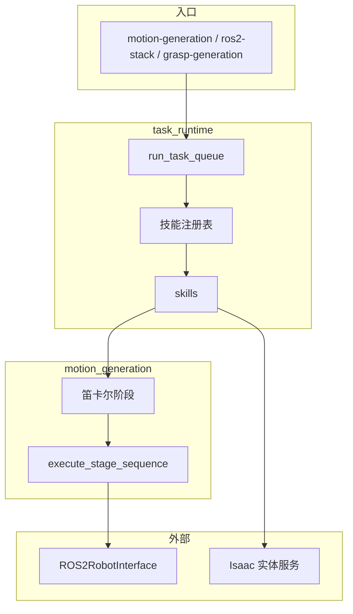

# robot-action-composer

在 ROS 2 上编排机器人任务。任务写成 YAML，程序按队列调用技能，再通过 `ROS2RobotInterface` 把运动发给机器人。

这个包有三条命令，可以分开用：

| 命令 | 做什么 |
|------|--------|
| `ros2-stack` | 按机器人配置启动运控和导航。不负责任务内容 |
| `motion-generation` | 选择机器人、任务和场景，按 `task_queue` 执行 |
| `grasp-generation` | 可选。头相机灵巧手抓取的调试界面。没装也不影响前面两条 |

底层控制器、Nav2 服务器和仿真场景不在这个包里。这里只调用已经起来的 ROS 2 接口和 Isaac 的实体服务。

父仓库的安装、依赖和 W2 启动例子见 [lerobot_ros2 README](https://github.com/fiveages-sim/lerobot_ros2)。仿真从零部署见飞书：[从零部署](https://lcnnwa8es0bc.feishu.cn/wiki/QjCpwrpWMiCsUbkJ8iCcN7n4ncx)。

https://github.com/user-attachments/assets/4c3bcf28-f2cd-4c47-83a0-ecccb30c1891

## 依赖

| 项 | 要求 |
|----|------|
| Python | 3.12。和 ROS 2 Jazzy 的 `rclpy` 放在同一个环境 |
| ROS 2 | Jazzy。运行前 source 发行版和运控工作空间 |
| 本包直接依赖 | `numpy>=1.26,<2`、`pyyaml`、已安装的 `ros2-robot-interface` |
| 导航任务 | 系统里的 Navigation2。本包不声明这个 apt 包 |
| 录制 | 可选 extra `recording`：`lerobot` 和 `lerobot-robot-ros2`。会用到 NumPy 2，不要和抓取共用一个环境 |
| 抓取界面 | 可选 extra `grasp`：`viser`。HUG 在父仓库的 `submodules/hug/.venv`（Python 3.10），不是本包的安装依赖 |

NumPy 保持 1.x，是为了和 Jazzy 里按 NumPy 1 编译的扩展兼容。

## 安装

在父仓库根目录安装，不要用系统 `pip`。

```bash
# 只做任务编排
./init.sh all-motion
./init.sh ros2-workspace
source .venv/bin/activate

# 还要灵巧手抓取
./init.sh all-grasp
```

`all-motion` 会安装 `ros2_robot_interface` 和本包。`all-grasp` 在此之上安装 `viser`、`wuji-sdk`，并创建 HUG 环境。录制另执行 `./init.sh install-lerobot`，使用另一个环境。

已经有父环境、只想补本包时：

```bash
source .venv/bin/activate
uv pip install -e submodules/ros2_robot_interface --no-deps
uv pip install 'numpy>=1.26,<2' pyyaml
uv pip install -e submodules/robot_action_composer --no-deps
```

本地包要加 `--no-deps`，否则安装器会到 PyPI 上找 `rclpy`。

## 使用

新开终端后先 `source` ROS 2、运控工作空间，再 `source` 父仓库的 `.venv/bin/activate`。在放着 `robots/` 的目录里运行，Isaac 示例是 `examples/IsaacSim`。

```bash
cd examples/IsaacSim

# 交互选择机器人、任务、场景
motion-generation

# 指定任务
motion-generation --robot fiveages_w2 --task-key navigate_and_dex_grasp --scene apple

# 先拉起运控和导航
ros2-stack launch --robot fiveages_w2 --group dex_hand
ros2-stack status --robot fiveages_w2
ros2-stack logs --robot fiveages_w2 -f
ros2-stack stop --robot fiveages_w2
```

`motion-generation` 扫描 `robots/` 下的 `robot.yaml` 和 `task_configs/`，一层厂商目录也可以。语言用 `--lang zh` 或环境变量 `MOTION_GENERATION_LANG`。上次的选择记在工作区的 `.motion_last.json`。

可选抓取界面：

```bash
grasp-generation serve --robot fiveages_w2 --workspace .
```

浏览器打开 Viser，默认端口 8080。任务队列里的同一步是技能 `dex_hand.auto_grasp`，不需要再开这个界面。

查仿真里某个 prim 的位姿，或把当前关节角打出来方便贴进任务文件：

```bash
check-isaac-pose /World/FiveAges_W2/base_link
check-robot-status --robot fiveages_w2 --workspace .
```

## 文档

| 文档 | 内容 |
|------|------|
| [docs/SKILLS_REFERENCE.md](docs/SKILLS_REFERENCE.md) | 每个技能的参数 |
| [docs/TASK_CONFIG_YAML.md](docs/TASK_CONFIG_YAML.md) | 任务 YAML 怎么写、怎么合并 |
| [docs/ROBOT_CONFIG.md](docs/ROBOT_CONFIG.md) | `robot.yaml` 和机器人目录 |
| [docs/ROS2_STACK.md](docs/ROS2_STACK.md) | `ros2-stack` 读哪些配置、导航 profile 是什么 |
| [docs/GRASP_GENERATION.md](docs/GRASP_GENERATION.md) | 抓取命令行、Viser、和任务队列的关系 |
| [docs/CLOSE_EXECUTORS.md](docs/CLOSE_EXECUTORS.md) | 合手的几种执行方式 |

## 代码怎么分工

运动和编排是两层：

- `motion_generation` 负责一段运动怎么生成、怎么发给机器人。
- `task_runtime` 负责按队列选技能、合并配置、把上下文传下去。



| 路径 | 作用 |
|------|------|
| `motion_generation/sequence/` | `StageTarget` 和按段执行 |
| `motion_generation/tasks/` | 抓取放置、双臂、抽屉等任务几何 |
| `task_runtime/runner.py` | 连接机器人、可选复位仿真、按队列执行 |
| `task_runtime/skills/` | 技能实现。导入时注册，未知名字会报已注册列表 |
| `task_config_io.py` | 扫描 `task_configs/**/*.yaml` |
| `isaac_sim/` | 仿真复位、实体位姿、仿真时间 |
| `ros2_stack/` | 按 `robot.yaml` 和场景 `.meta/ros2_stack.yaml` 启动运控、导航 |
| `grasp_generation/` | 可选抓取库。HUG、重定向、合手 |
| `dataset_recording/` | 可选录制。运动仍走 `ROS2RobotInterface` |
| `cli/` | 上面几条命令的入口 |

导航技能在 `task_runtime/skills/navigation.py`，调用接口上的 `send_nav_goal` 和 `wait_nav_arrived`。纯编排不依赖 LeRobot 的 `ROS2Robot` 类。

## 技能

`task_queue` 里的 `skill` 必须是下表中的名字。参数以 [docs/SKILLS_REFERENCE.md](docs/SKILLS_REFERENCE.md) 为准。函数约定是 `(ctx, params) -> (阶段列表, 执行信息)`。导航、关节运动这类没有笛卡尔阶段的技能返回空列表。

| 技能 | 文件 | 作用 |
|------|------|------|
| `single_arm.pick` | `single_arm.py` | 单臂抓取 |
| `single_arm.move_to_object` | `single_arm.py` | 移到物体附近，不抓 |
| `single_arm.place` | `single_arm.py` | 单臂放置 |
| `single_arm.move_to_pose` | `single_arm.py` | 移到给定末端位姿 |
| `single_arm.move_relative` | `single_arm.py` | 相对当前末端平移或转向 |
| `single_arm.goto_cache_pose` | `single_arm.py` | 回到缓存的末端位姿 |
| `single_arm.drawer.pull_open` | `drawer.py` | 拉开抽屉 |
| `single_arm.drawer.close_push` | `drawer.py` | 推合抽屉 |
| `dual_arm.carry` | `dual_arm.py` | 双臂搬运 |
| `dual_arm.parallel_pick` | `dual_arm.py` | 双臂同时抓取 |
| `dual_arm.bimanual_align` | `dual_arm.py` | 持物时对齐双臂 |
| `dual_arm.place` | `dual_arm.py` | 双臂放置 |
| `dual_arm.handover` | `dual_arm.py` | 双臂交接 |
| `dual_arm.goto_cache_pose` | `dual_arm.py` | 双臂回到缓存位姿 |
| `nav.send_nav_goal` | `navigation.py` | 发出导航目标，不等待 |
| `nav.wait_nav_arrived` | `navigation.py` | 等待导航结束 |
| `nav.navigate_to_pose` | `navigation.py` | 导航到给定位姿 |
| `nav.navigate_to_object` | `navigation.py` | 导航到物体附近 |
| `nav.navigate_relative` | `navigation.py` | 相对当前底盘移动 |
| `dex_hand.auto_grasp` | `dex_hand.py` | 头相机灵巧手抓取 |
| `joint.movej_to_config` | `joint.py` | 关节运动到给定角度 |
| `joint.goto_cached_joints` | `joint.py` | 回到缓存关节角 |
| `session.scratch_put` | `session.py` | 往会话暂存写一个值 |
| `session.scratch_clear` | `session.py` | 清空会话暂存 |
| `robot.cache_ee_pose` | `session.py` | 缓存当前末端位姿 |
| `robot.cache_joint_state` | `session.py` | 缓存当前关节角 |
| `robot.snapshot_state` | `session.py` | 打印当前状态，便于调试 |
| `robot.send_mode_command` | `session.py` | 发送模式命令 |
| `env.randomize_object_local_xyz` | `env.py` | 仿真里随机挪动物体 |

配置从 `runtime_defaults`、`skill_defaults` 和场景里的 `skill_params` 叠在一起。场景自己的运控和导航写在任务目录的 `.meta/ros2_stack.yaml`，不要写进任务 YAML。
